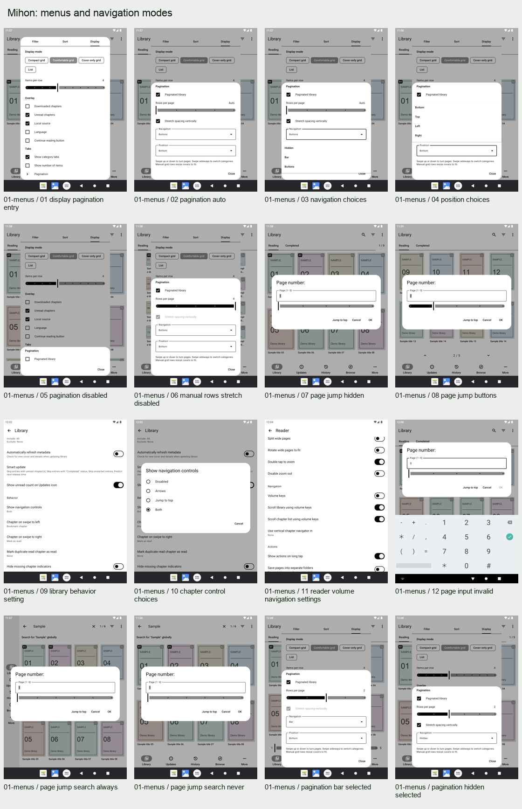
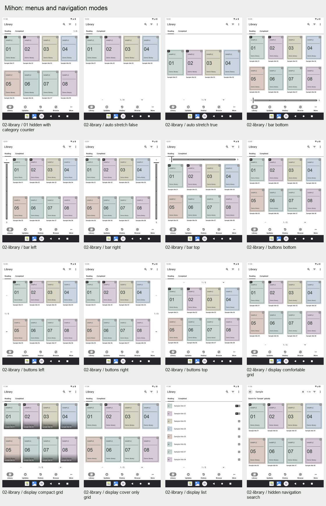
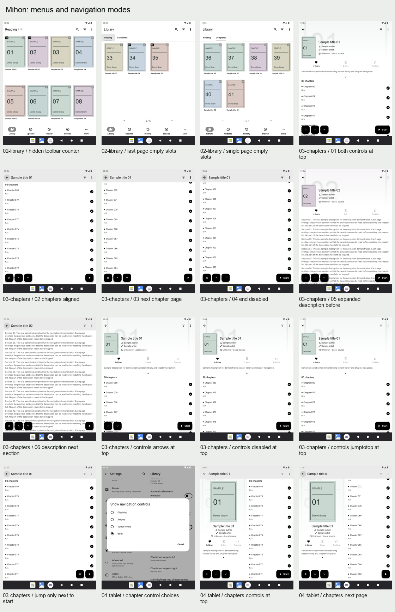
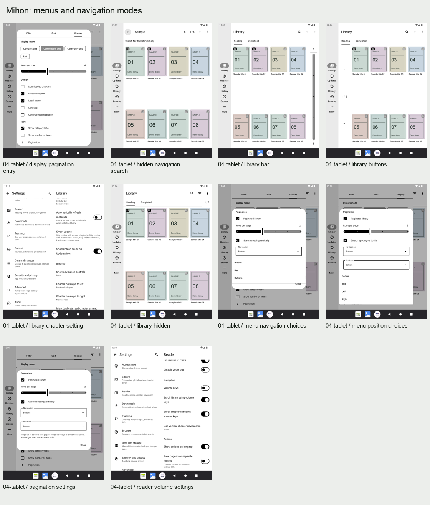
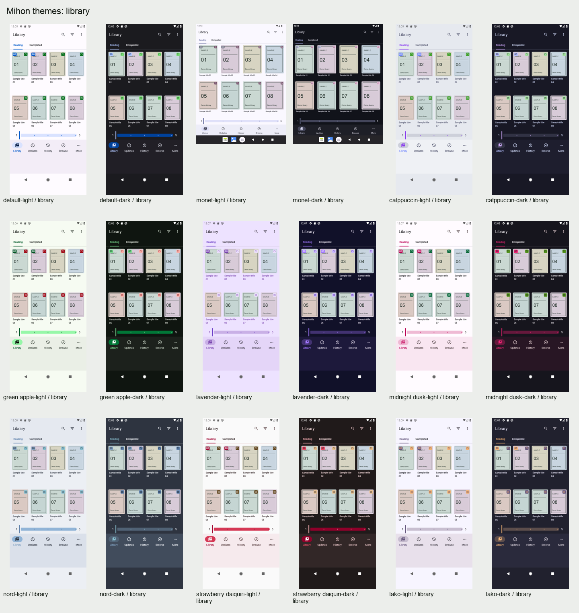
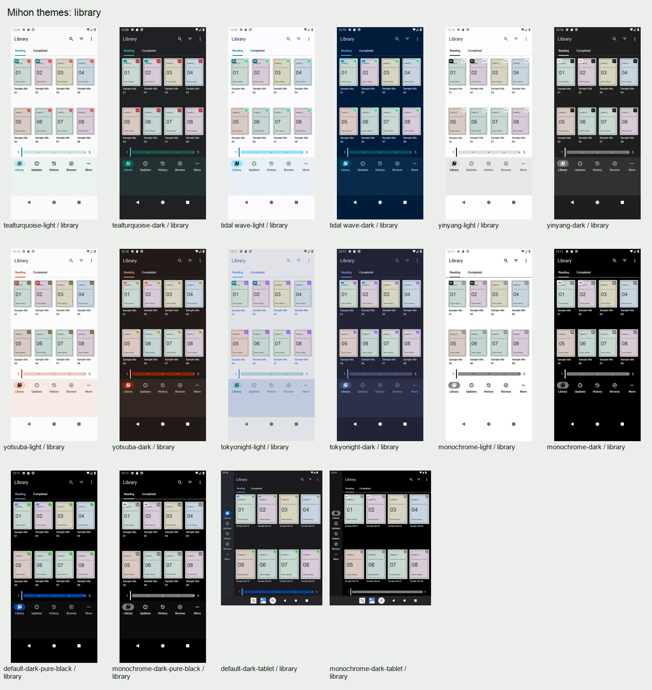
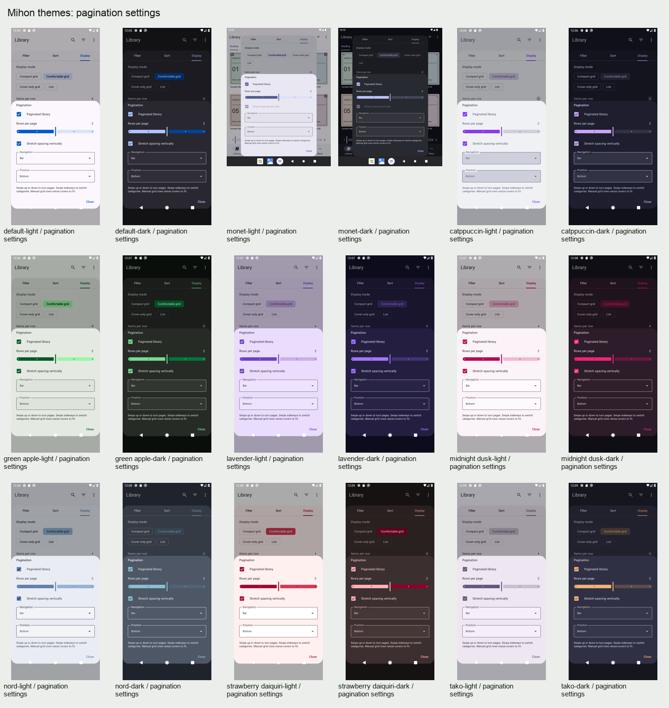
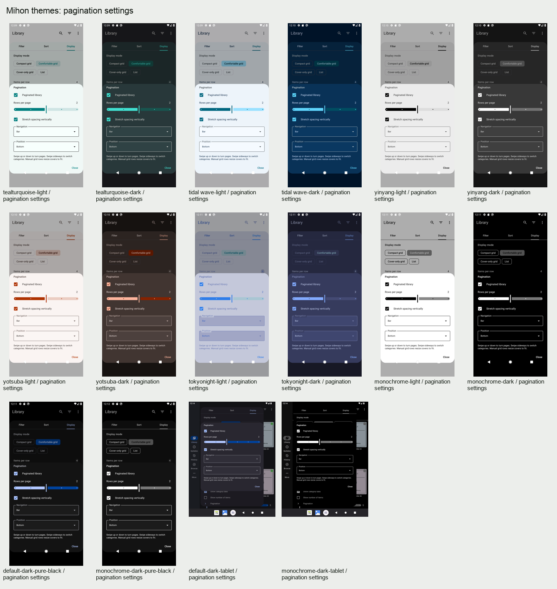
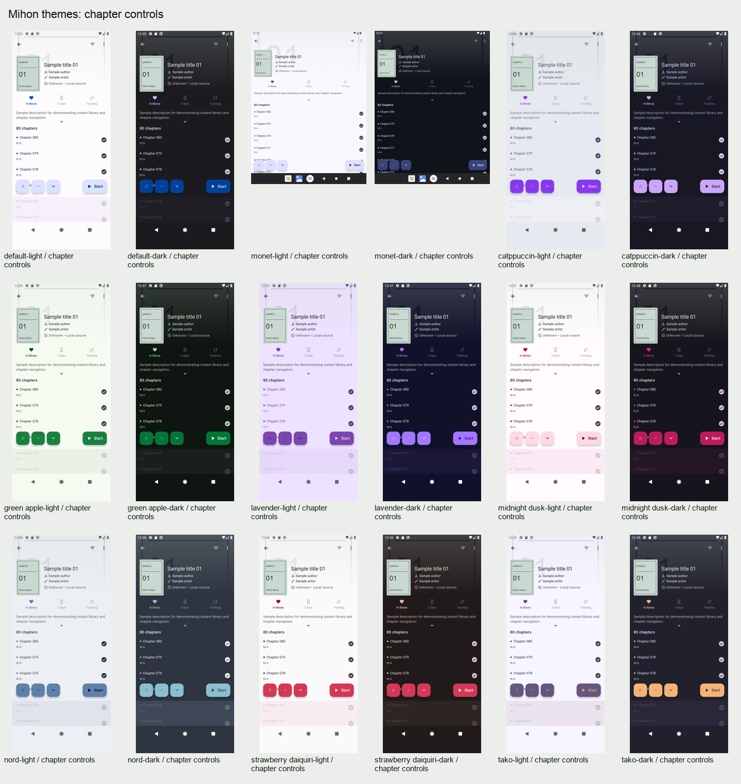
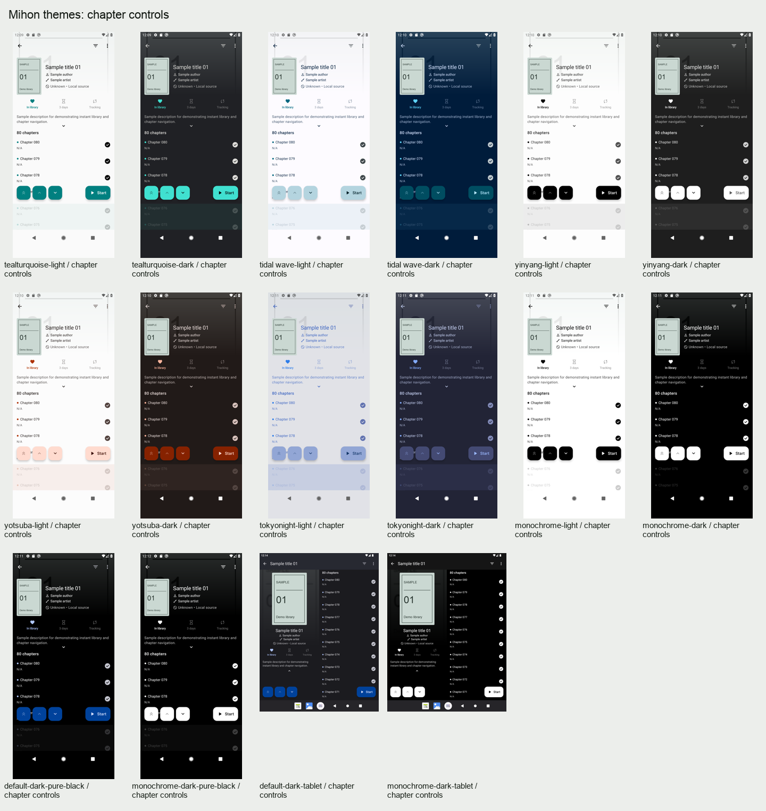

# E-paper support PR screenshots

Captured from the reviewed source in [`e478c445a`](https://github.com/la-fiksero-fatala/mihon/commit/e478c445a9da5914df217dce2f29f7072ac73a7c). All library entries and covers are fictional sample data.

This branch contains screenshot assets only: 58 menu/mode captures, 102 theme-check captures, and ten overview sheets. The app changes are on the fork's `main` branch.

## Original images

- [Settings and dialogs](screenshots/01-menus)
- [Library display/navigation modes](screenshots/02-library)
- [Chapter navigation](screenshots/03-chapters)
- [Tablet variants](screenshots/04-tablet)
- [All 15 base themes, light/dark and additional variants](theme-checks)

## Menu and mode overview

Theme verification overview

